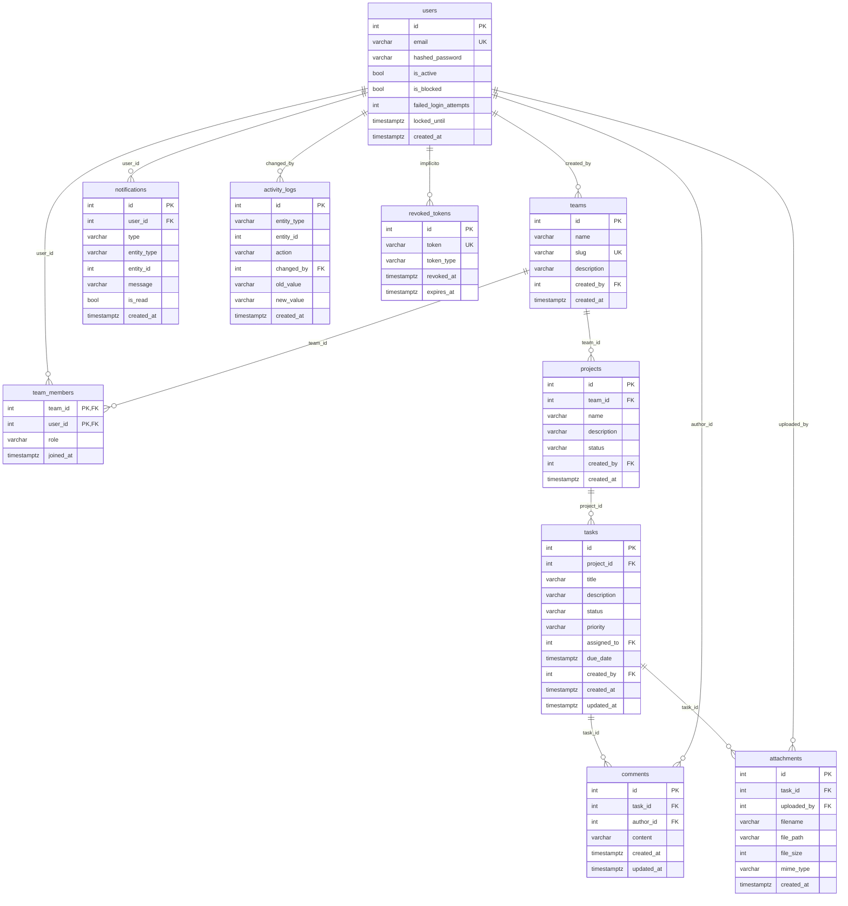

# Modelo de datos — TaskFlow

**Versión:** 1.0
**DB objetivo:** PostgreSQL 15+
**Migraciones:** Alembic (única fuente en producción)
**Convenciones:** snake_case, `timestamptz` en UTC, PK entera autoincremental salvo indicación, enums como `VARCHAR + CHECK` (no enums nativos, para facilitar migraciones).

---

## 1. ERD actual



> `activity_logs` es polimórfica (`entity_type` + `entity_id`), por lo que no tiene FK a la entidad.

---

## 2. Modelo actual — detalle

### `users`

| Columna | Tipo | Restricciones |
|---|---|---|
| `id` | `serial` | PK |
| `email` | `varchar(255)` | UNIQUE, NOT NULL |
| `hashed_password` | `varchar(255)` | NOT NULL |
| `is_active` | `boolean` | DEFAULT true |
| `is_blocked` | `boolean` | DEFAULT false |
| `failed_login_attempts` | `integer` | DEFAULT 0 |
| `locked_until` | `timestamptz` | NULL |
| `token_version` | `integer` | NOT NULL, DEFAULT 0 |
| `created_at` | `timestamptz` | DEFAULT now() |
| `updated_at` | `timestamptz` | DEFAULT now(), on update |
| `last_login_at` | `timestamptz` | NULL |
| `password_changed_at` | `timestamptz` | NULL |
| `muted_notification_types` | `varchar(200)` | NOT NULL, DEFAULT `''` |

### `teams`

| Columna | Tipo | Restricciones |
|---|---|---|
| `id` | `serial` | PK |
| `name` | `varchar(255)` | NOT NULL |
| `slug` | `varchar(255)` | UNIQUE, NOT NULL |
| `description` | `varchar(500)` | NULL |
| `created_by` | `integer` | FK `users.id`, NOT NULL |
| `created_at` | `timestamptz` | DEFAULT now() |
| `updated_at` | `timestamptz` | DEFAULT now(), on update |

### `team_members`

| Columna | Tipo | Restricciones |
|---|---|---|
| `team_id` | `integer` | PK, FK `teams.id` ON DELETE CASCADE |
| `user_id` | `integer` | PK, FK `users.id` ON DELETE CASCADE |
| `role` | `varchar(20)` | DEFAULT `member`, índice |
| `joined_at` | `timestamptz` | DEFAULT now() |

### `projects`

| Columna | Tipo | Restricciones |
|---|---|---|
| `id` | `serial` | PK |
| `team_id` | `integer` | FK `teams.id` ON DELETE CASCADE, NOT NULL, índice |
| `name` | `varchar(255)` | NOT NULL |
| `slug` | `varchar(255)` | NOT NULL, índice, UNIQUE `(team_id, slug)` |
| `description` | `varchar(500)` | NULL |
| `status` | `varchar(20)` | DEFAULT `active`, índice |
| `created_by` | `integer` | FK `users.id`, NOT NULL |
| `created_at` | `timestamptz` | DEFAULT now() |
| `updated_at` | `timestamptz` | DEFAULT now(), on update |

Índices: `(team_id, status)` y `(team_id, slug)` UNIQUE. Migración
`e5f6a7b8c9d0` (M-02) con backfill determinista y sufijos ante colisiones.

### `tasks`

| Columna | Tipo | Restricciones |
|---|---|---|
| `id` | `serial` | PK |
| `project_id` | `integer` | FK `projects.id` ON DELETE CASCADE, NOT NULL |
| `title` | `varchar(255)` | NOT NULL |
| `description` | `varchar(1000)` | NULL |
| `status` | `varchar(20)` | DEFAULT `todo` |
| `priority` | `varchar(20)` | DEFAULT `medium` |
| `assigned_to` | `integer` | FK `users.id`, NULL |
| `due_date` | `timestamptz` | NULL |
| `created_by` | `integer` | FK `users.id`, NOT NULL |
| `created_at` | `timestamptz` | DEFAULT now() |
| `updated_at` | `timestamptz` | DEFAULT now(), ON UPDATE now() |

Índices: `(project_id, status)`, `(project_id, priority)`, `(assigned_to)`, `(due_date)`, `(created_at)`.

### `comments`

| Columna | Tipo | Restricciones |
|---|---|---|
| `id` | `serial` | PK |
| `task_id` | `integer` | FK `tasks.id` ON DELETE CASCADE, NOT NULL |
| `author_id` | `integer` | FK `users.id`, NOT NULL |
| `content` | `varchar(2000)` | NOT NULL |
| `created_at` | `timestamptz` | DEFAULT now() |
| `updated_at` | `timestamptz` | DEFAULT now(), ON UPDATE now() |

### `attachments`

| Columna | Tipo | Restricciones |
|---|---|---|
| `id` | `serial` | PK |
| `task_id` | `integer` | FK `tasks.id` ON DELETE CASCADE, NOT NULL |
| `uploaded_by` | `integer` | FK `users.id`, NOT NULL |
| `filename` | `varchar(255)` | NOT NULL |
| `file_path` | `varchar(500)` | NULL (solo backend local) |
| `content` | `bytea` | NULL (backend database) |
| `checksum` | `char(64)` | NULL; SHA-256 en subidas nuevas |
| `file_size` | `integer` | NOT NULL |
| `mime_type` | `varchar(100)` | NOT NULL |
| `created_at` | `timestamptz` | DEFAULT now() |

### `activity_logs`

| Columna | Tipo | Restricciones |
|---|---|---|
| `id` | `serial` | PK |
| `entity_type` | `varchar(50)` | NOT NULL |
| `entity_id` | `integer` | NOT NULL |
| `action` | `varchar(50)` | NOT NULL |
| `changed_by` | `integer` | FK `users.id`, NOT NULL |
| `old_value` | `varchar(1000)` | NULL |
| `new_value` | `varchar(1000)` | NULL |
| `created_at` | `timestamptz` | DEFAULT now() |

### `notifications`

| Columna | Tipo | Restricciones |
|---|---|---|
| `id` | `serial` | PK |
| `user_id` | `integer` | FK `users.id`, NOT NULL |
| `type` | `varchar(50)` | NOT NULL |
| `entity_type` | `varchar(50)` | NOT NULL |
| `entity_id` | `integer` | NOT NULL |
| `message` | `varchar(500)` | NOT NULL |
| `is_read` | `boolean` | DEFAULT false |
| `dedupe_key` | `varchar(255)` | UNIQUE, NULL (idempotencia por evento) |
| `created_at` | `timestamptz` | DEFAULT now() |

Migración `c9d0e1f2a3b4`: añade `dedupe_key` y
`users.muted_notification_types`.

### `revoked_tokens`

| Columna | Tipo | Restricciones |
|---|---|---|
| `id` | `serial` | PK |
| `token` | `varchar(500)` | UNIQUE, NOT NULL, índice |
| `token_type` | `varchar(20)` | DEFAULT `access` |
| `revoked_at` | `timestamptz` | DEFAULT now() |
| `expires_at` | `timestamptz` | NOT NULL |

---

## 3. Modelo objetivo — cambios

### 3.1 `users`

| Cambio | Motivo |
|---|---|
| Email almacenado en minúsculas + unique funcional | Evitar duplicados `User@x.com` vs `user@x.com` |
| `last_login_at timestamptz` | Operación y auditoría |
| `password_changed_at timestamptz` | Revocación de sesiones |
| `token_version integer default 0` | Invalidar access tokens sin consultar tabla (opcional, alternativa a blacklist) |

### 3.2 `teams`

| Cambio | Motivo |
|---|---|
| `updated_at timestamptz` | Auditar cambios |
| `archived_at timestamptz NULL` | Borrado lógico si se aprueba |
| `slug` generado en servidor, único, `CHECK (slug ~ '^[a-z0-9-]+$')` | URL estable |

### 3.3 `team_members`

| Cambio | Motivo |
|---|---|
| `CHECK (role IN ('admin','member'))` | Integridad |
| Índice `(user_id)` | Listar equipos del usuario |
| `invited_by integer NULL` | Trazabilidad si se implementan invitaciones |

### 3.4 `projects`

| Cambio | Motivo |
|---|---|
| `slug varchar(255)` único por equipo | Identificador estable |
| `UNIQUE (team_id, slug)` | Evitar colisiones |
| `updated_at timestamptz` | Auditar |
| `archived_at timestamptz NULL` (o mantener `status`) | Semántica explícita |
| `CHECK (status IN ('active','archived'))` | Integridad |
| Índice `(team_id, status, created_at)` | Listados |

### 3.5 `tasks`

| Cambio | Motivo |
|---|---|
| `position numeric(20,10) NOT NULL DEFAULT 0` | Orden estable en Kanban |
| `completed_at timestamptz NULL` | Métricas y filtros |
| `CHECK (status IN ('todo','in_progress','done'))` | Integridad |
| `CHECK (priority IN ('low','medium','high'))` | Integridad |
| Índice `(project_id, status, position)` | Tablero eficiente |
| Índice `(project_id, assigned_to, status)` | Filtros |
| `CHECK (due_date IS NULL OR due_date > created_at - interval '1 day')` (opcional) | Validación de fechas |

### 3.6 `comments`

| Cambio | Motivo |
|---|---|
| `CHECK (char_length(content) BETWEEN 1 AND 2000)` | Integridad |
| Índice `(task_id, created_at)` | Listado paginado |
| `deleted_at timestamptz NULL` (opcional) | Moderación/soft delete |

### 3.7 `attachments`

| Cambio | Motivo |
|---|---|
| `storage_key varchar(500) UNIQUE NOT NULL` | Clave en object storage |
| `original_filename varchar(255)` | Nombre mostrado |
| `checksum char(64)` | Integridad SHA-256 |
| `file_size bigint` | Soportar > 2 GB si se amplía límite |
| `mime_type varchar(150)` | Allowlist |
| `updated_at timestamptz` | Auditoría |
| Deprecar/eliminar `file_path` | No exponer rutas internas |
| Índice `(task_id, created_at)` | Listado |

### 3.8 `activity_logs`

| Cambio | Motivo |
|---|---|
| `metadata jsonb` | Diff estructurado y extensible |
| `actor_email` no se guarda; se resuelve por FK | Evitar duplicar PII |
| Índice `(entity_type, entity_id, created_at)` | Consultas paginadas |
| `CHECK (entity_type IN ('task','project','team','comment','attachment','member'))` (opcional) | Integridad |
| Trigger de inmutabilidad (opcional) | Auditoría |

### 3.9 `notifications`

| Cambio | Motivo |
|---|---|
| `read_at timestamptz NULL` | Sustituir/complementar `is_read` |
| `dedupe_key varchar(255) NULL` | Evitar duplicados |
| `UNIQUE (user_id, dedupe_key)` (parcial, donde no null) | Idempotencia |
| Índice `(user_id, read_at, created_at DESC)` | Contador y listado |
| `CHECK (type IN ('assigned','commented','mentioned','updated'))` (opcional) | Integridad |

### 3.10 Nuevas tablas

#### `refresh_sessions`

| Columna | Tipo | Restricciones |
|---|---|---|
| `id` | `bigserial` | PK |
| `user_id` | `integer` | FK `users.id` ON DELETE CASCADE, NOT NULL |
| `jti` | `uuid` | UNIQUE NOT NULL |
| `token_hash` | `char(64)` | UNIQUE NOT NULL (SHA-256) |
| `family_id` | `uuid` | NOT NULL, índice |
| `user_agent` | `varchar(500)` | NULL |
| `ip` | `inet` | NULL |
| `created_at` | `timestamptz` | DEFAULT now() |
| `expires_at` | `timestamptz` | NOT NULL |
| `revoked_at` | `timestamptz` | NULL |
| `replaced_by_jti` | `uuid` | NULL |

Índices: `(user_id)`, `(family_id)`, `(expires_at)`.

#### `revoked_access_tokens`

| Columna | Tipo | Restricciones |
|---|---|---|
| `jti` | `uuid` | PK |
| `expires_at` | `timestamptz` | NOT NULL, índice |

> Sustituye a `revoked_tokens` para access tokens. El refresh se gestiona en `refresh_sessions`. La tabla antigua se migra y se elimina en un release posterior.

#### `team_invites` (opcional, `Could`)

| Columna | Tipo | Restricciones |
|---|---|---|
| `id` | `bigserial` | PK |
| `team_id` | `integer` | FK `teams.id` ON DELETE CASCADE |
| `email` | `varchar(255)` | NOT NULL |
| `role` | `varchar(20)` | DEFAULT `member` |
| `token_hash` | `char(64)` | UNIQUE NOT NULL |
| `invited_by` | `integer` | FK `users.id` |
| `created_at` | `timestamptz` | DEFAULT now() |
| `expires_at` | `timestamptz` | NOT NULL |
| `accepted_at` | `timestamptz` | NULL |

Índice único parcial: `(team_id, email) WHERE accepted_at IS NULL`.

---

## 4. Índices objetivo

| Tabla | Índice | Uso |
|---|---|---|
| `users` | `lower(email)` UNIQUE | Login/registro |
| `teams` | `slug` UNIQUE | Lookup |
| `team_members` | `(user_id)` | Dashboard |
| `team_members` | `(team_id, role)` | Admin checks |
| `projects` | `(team_id, status, created_at)` | Listado |
| `projects` | `(team_id, slug)` UNIQUE | Lookup |
| `tasks` | `(project_id, status, position)` | Kanban |
| `tasks` | `(project_id, assigned_to, status)` | Filtros |
| `tasks` | `(project_id, due_date)` | Fechas |
| `comments` | `(task_id, created_at)` | Listado |
| `attachments` | `(task_id, created_at)` | Listado |
| `notifications` | `(user_id, read_at, created_at DESC)` | Campana |
| `activity_logs` | `(entity_type, entity_id, created_at DESC)` | Historial |
| `refresh_sessions` | `(user_id)`, `(family_id)`, `(expires_at)` | Sesiones/limpieza |
| `revoked_access_tokens` | `(expires_at)` | Limpieza |

---

## 5. Reglas de integridad y negocio

1. Un equipo siempre tiene al menos un `admin`. Se valida en servicio y, si es posible, con trigger.
2. Un usuario no puede tener dos membresías en el mismo equipo (PK compuesta).
3. Un proyecto pertenece a un equipo; una tarea a un proyecto; un comentario/adjunto a una tarea.
4. `assigned_to` debe ser miembro del equipo del proyecto. Validación en servicio + test.
5. `created_by` no se modifica.
6. `status`/`priority`/`role` solo aceptan valores del enum.
7. `due_date` en UTC; la UI convierte.
8. `notifications.user_id` solo puede leer/marcar sus propias filas.
9. `attachments.storage_key` es inmutable.
10. `activity_logs` es append-only (sin UPDATE/DELETE desde la app).
11. Borrar tarea → borrar comentarios, adjuntos (DB) y objetos (storage). Borrar proyecto → cascada de tareas.
12. Borrar equipo → cascada de membresías, proyectos, tareas, comentarios, adjuntos y objetos.

---

## 6. Estrategia de migraciones

### Reglas

- Una migración por PR, con `upgrade` y `downgrade`.
- Sin `DROP` de columnas en el mismo release que deja de usarse (expand/contract).
- Backfills por lotes y idempotentes.
- CI ejecuta `alembic upgrade head` y `alembic downgrade -1` sobre Postgres limpio.
- Producción: migración compatible → deploy API → verificar → cleanup en release posterior.

### Plan

| ID | Migración | Pasos | Rollback |
|---|---|---|---|
| M-01 | Constraints y columnas de auditoría | **Implementado** en `a7b8c9d0e1f2`: `updated_at`, `last_login_at`, `password_changed_at`, CHECK de roles/estados/prioridades/tipos | `downgrade` elimina columnas/constraints |
| M-02 | Slugs de proyecto | Añadir `slug NULL`; backfill `slugify(name)` + sufijo; unique; `NOT NULL` | Eliminar unique/columna |
| M-03 | Storage de adjuntos | 🟡 Parcial: `checksum` añadido en `b8c9d0e1f2a3` con backfill de contenido en DB; `content` cubre persistencia. Falta `storage_key`/S3 y deprecar `file_path` | Restaurar lectura por `file_path`; mantener columnas |
| M-04 | Sesiones de refresh | Crear `refresh_sessions` y `revoked_access_tokens`; dual-write; migrar tokens vigentes; retirar `revoked_tokens` en release posterior | Volver a `revoked_tokens`; conservar tablas |
| M-05 | Posición de tareas | Añadir `position NULL`; backfill por `created_at`; default; `NOT NULL` | Eliminar columna |
| M-06 | Notificaciones | Añadir `read_at`; backfill desde `is_read`; índice; conservar `is_read` temporalmente | Eliminar `read_at`/índice |
| M-07 | Invitaciones (opcional) | Crear `team_invites` | Drop table |
| M-08 | Índices de lectura | **Implementado** en `a7b8c9d0e1f2` para team_members, projects, tasks, comments, attachments y notifications | Drop indexes |

### Backfill de ejemplo (slugs)

```sql
-- 1. Añadir nullable
ALTER TABLE projects ADD COLUMN slug varchar(255);

-- 2. Backfill determinista (pseudo)
UPDATE projects
SET slug = lower(regexp_replace(name, '[^a-zA-Z0-9]+', '-', 'g')) || '-' || id
WHERE slug IS NULL;

-- 3. Unicidad y NOT NULL
CREATE UNIQUE INDEX uq_projects_team_slug ON projects(team_id, slug);
ALTER TABLE projects ALTER COLUMN slug SET NOT NULL;
```

> El backfill real se implementa en Python con `slugify` y control de colisiones, ejecutado por lotes.

---

## 7. Retención y limpieza

| Dato | Retención | Mecanismo |
|---|---|---|
| `refresh_sessions` expiradas | 7 días | Job diario |
| `revoked_access_tokens` expirados | 15 min + margen | Job horario |
| `notifications` leídas | 90 días | Job diario (configurable) |
| `activity_logs` | 1 año | Job mensual/particionado (futuro) |
| Adjuntos de tareas borradas | Inmediato | Servicio de borrado + reconciliación |
| Equipos/proyectos archivados | 30 días antes de purga (si aplica) | Job + confirmación |
| Backups | 30 días | InsForge/ops |

---

## 8. Backup y restore

- Backup automático diario de PostgreSQL (InsForge) + retención 30 días.
- Prueba de restore trimestral en entorno aislado.
- RPO ≤ 24 h; RTO ≤ 4 h.
- Los objetos de storage se versionan o se copian a un bucket secundario (según proveedor).
- Documentar en `runbook` el procedimiento y los responsables.

---

## 9. Compatibilidad y datos existentes

- `schema.sql` se elimina (ADR-004).
- La DB actual puede no coincidir exactamente con los modelos (p. ej. `team_members`). Antes de M-01, ejecutar un diff de esquema y crear una migración baseline si es necesario.
- Los datos existentes se preservan; los campos nuevos son nullable o tienen default.
- Los slugs se generan sin cambiar nombres visibles.
- Los adjuntos existentes se migran con checksum calculado y verificación.
- Los tokens actuales se pueden invalidar en el despliegue de M-04 (logout forzado) si la migración no permite preservarlos; documentarlo.
